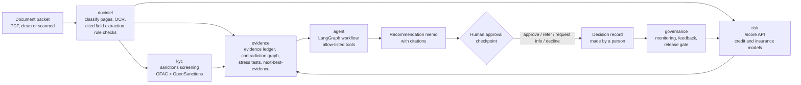

# Underwriting Copilot: evidence-driven underwriting intelligence

An AI underwriting platform for **small-business loans** and **commercial insurance submissions**.

A packet of documents goes in. Out come:

- extracted fields, each with a page citation
- cross-document contradictions (for example, stated revenue vs bank deposits), separated into benign and unsupported
- a sanctions / KYC screening result
- a calibrated risk score with plain-language reason codes
- stress tests: how the risk and the recommendation change if revenue drops, rates rise, or claims increase
- the next piece of evidence worth requesting, ranked by whether it could change the decision
- a recommendation memo and an auditable decision record that **a human must approve**

The copilot never auto-declines. Every decline, sanctions hit, and reconciliation failure goes to a human reviewer.

> **Synthetic data notice.** This is a portfolio project. It uses only public datasets and **synthetic**
> (computer-generated) documents, customers, and news snippets. It contains no real personal data and has no
> production users. Every synthetic artifact is labeled as synthetic.

## Problem

Underwriters spend much of their time reading packets (applications, bank statements, financials, loss runs),
re-keying numbers, checking that the numbers agree, screening names against sanctions lists, and writing up a
recommendation. This project automates the reading and checking, and leaves the decision to a person.

The central question: how can a lender or insurer decide faster while showing that every important conclusion
is supported by evidence, financially justified, consistent with policy, and safe to act on?

The planned signature component is the **Evidence-to-Action Engine** (Phase 4). It will tag every claim as verified, model estimate,
conflicting, or unknown; run stress scenarios through the risk models; check whether resolving each open
question would change the recommendation; and recommend the next document to request.

## Architecture



| Package | Phase | Purpose | On this branch (`genai-track`) |
|---|---|---|---|
| `src/uwcopilot/risk` | 1 | Credit-default (Lending Club) and claim frequency/severity (freMTPL2) models, scenario interface, model cards, `/score` API | Only `client.py`: the HTTP client of the `/score` service, shared by the agent and the MCP server. The models are on the Phase 1 branch. |
| `src/uwcopilot/docintel` | 2 | Synthetic packet generator, OCR, LLM field extraction with citations, deterministic checks, contradiction graph, prompt-injection detection | Not built |
| `src/uwcopilot/kyc` | 3 | Watchlist loading, name matching, embedding reranker, adverse-media memo stub | Built ([walkthrough](docs/walkthrough_phase3.md)) |
| `src/uwcopilot/evidence` | 4 | Evidence ledger, financial calculations, stress tests, next-best-evidence ranking, decision records | Not built |
| `src/uwcopilot/agent` | 5 | LangGraph agent with a human-approval checkpoint, role-based access, tracing, adversarial evaluation | Built ([design](docs/agent_design.md), [walkthrough](docs/walkthrough_phase5.md)) |
| `src/uwcopilot/governance` | 6 | Versioning, monitoring, reviewer feedback, champion/challenger, CI release gate | Not built |
| `src/uwcopilot/llm` | GenAI | Provider adapter (Anthropic, OpenAI, fake) with explicit settings, cost cap, response cache | Built ([walkthrough](docs/walkthrough_genai.md)) |
| `src/uwcopilot/rag` | GenAI | Retrieval over SYNTHETIC guidelines + public regulatory documents in Qdrant: dense, BM25, hybrid, reranked | Built ([design](docs/rag_design.md)) |
| `src/uwcopilot/tools`, `src/uwcopilot/mcp_server` | GenAI | The tool allow-list with strict schemas, exposed to any MCP client | Built ([design](docs/mcp.md)) |
| `src/uwcopilot/observability` | GenAI | OpenTelemetry / OpenInference spans with PII redaction | Built |
| `src/uwcopilot/common` | 0 | Shared helpers (paths, checksums, settings reader) | Built |

The diagram shows the planned design. Each component is built in the phase listed above; see
[docs/build_prompts.md](docs/build_prompts.md) for the full plan. The last column says what exists on this branch;
a component marked "not built" does not exist yet.

## Datasets and licenses

Raw data is **never committed**. `make data` downloads everything into `data/raw/` and logs a SHA-256 checksum
for each file in `data/raw/checksums.jsonl`.

| Dataset | Used for | Source | License / terms |
|---|---|---|---|
| Lending Club accepted loans 2007-2018 | Credit-default model | Kaggle `wordsforthewise/lending-club` | See the Kaggle dataset page. Needs a Kaggle API key. |
| freMTPL2freq / freMTPL2sev | Insurance claim-frequency model | OpenML [41214](https://www.openml.org/d/41214) / [41215](https://www.openml.org/d/41215) (originally from the CASdatasets R package) | OpenML lists CC0 |
| UCI Statlog German Credit | Fairness demonstration | [UCI ML Repository](https://archive.ics.uci.edu/dataset/144/statlog+german+credit+data) | CC BY 4.0 |
| OFAC SDN list (+ aliases) | Sanctions screening | [US Treasury OFAC](https://www.treasury.gov/ofac/downloads/sdn.csv) | US government public data |
| OpenSanctions "default" (simplified CSV) | Sanctions screening | [OpenSanctions](https://www.opensanctions.org/datasets/default/) | CC BY-NC 4.0. Data from OpenSanctions.org, used non-commercially with attribution. |
| Synthetic packets, customers, news snippets | Document intelligence, KYC, agent evaluation | Generated by scripts in this repo | Synthetic, generated here |

## How to run

Requires Python 3.11 and [uv](https://docs.astral.sh/uv/).

```bash
cp .env.example .env      # add your Kaggle key (and an LLM key from Phase 2 on); every setting is documented there
make setup                # install exact versions from uv.lock
make ci                   # what CI runs: ruff lint + format check, offline tests
make data                 # download the public datasets
```

The GenAI-track steps, in order (`make all` runs everything):

```bash
make index                # Qdrant index of the guidelines + regulatory documents (fastembed models, no torch)
make eval-rag             # retrieval evaluation -> results/rag_metrics.json
make kyc-data eval-kyc    # SYNTHETIC KYC customers, sanctions screening evaluation -> results/kyc_metrics.json
make eval-agent           # LangGraph agent on 65 SYNTHETIC applications -> results/agent_metrics.json
make eval-agent-homonyms  # sensitivity run without the namesake redraw -> results/agent_metrics_homonyms_kept.json
make mcp-smoke            # MCP server smoke test over stdio and streamable HTTP -> results/mcp_smoke_*.json
make readme-results       # rewrite the results table below from results/*.json
make agent-demo           # one fake-LLM run to the human checkpoint, then a scripted demo decision
make mcp                  # serve the tools to an MCP client over stdio
```

There is no LLM API key in this environment, so no LLM call has been made; every metric that needs a model says
"not measured". Run `make help` to see every target.

## Results

No number in these tables is typed by hand. Rows that have not been run say "not measured".

Phase 1 risk models and the other phases (the risk-model rows are written by the Phase 1 report script, which is
not on this branch):

<!-- RESULTS:START -->
| Component | Metric | Value |
|---|---|---|
| Credit-default model (Lending Club) | Test AUC | not measured |
| Insurance frequency model (freMTPL2) | Mean Poisson deviance | not measured |
| Document extraction | Field F1 | not measured |
| Contradiction detection | Recall | not measured |
| Evidence-to-Action Engine | Next-best-evidence top-3 accuracy | not measured |
<!-- RESULTS:END -->

GenAI track: retrieval, sanctions screening, the agent and the MCP server, written by `make readme-results`
(`scripts/update_readme_results.py`) from `results/*.json`. A unit test fails if this table and the results files
disagree.

<!-- GENAI-RESULTS:START -->
| Component | Metric | Value |
|---|---|---|
| RAG retrieval, dense (103 answerable SYNTHETIC questions) | Recall@5 / MRR@10 [95% CI] | 0.8786 [0.8155, 0.9369] / 0.7416 [0.6737, 0.8077] |
| RAG retrieval, bm25 (103 answerable SYNTHETIC questions) | Recall@5 / MRR@10 [95% CI] | 0.8107 [0.7379, 0.8835] / 0.6349 [0.5591, 0.7065] |
| RAG retrieval, hybrid (103 answerable SYNTHETIC questions) | Recall@5 / MRR@10 [95% CI] | 0.9029 [0.8447, 0.9563] / 0.7788 [0.7170, 0.8380] |
| RAG retrieval, hybrid_rerank (103 answerable SYNTHETIC questions) | Recall@5 / MRR@10 [95% CI] | 0.9078 [0.8544, 0.9563] / 0.8285 [0.7683, 0.8846] |
| RAG retrieval, hybrid_rerank minus dense | Paired difference in recall@5 [95% CI] | 0.0291 [-0.0291, 0.0874] |
| RAG answers | Faithfulness / citation accuracy | not measured (no LLM key) |
| Sanctions screening, rules only (SYNTHETIC test customers) | Recall of true matches [95% CI] | 0.6889 [0.5476, 0.8182] |
| Sanctions screening, rules only (SYNTHETIC test customers) | Alerts per 1,000 screened [95% CI] | 103.8 [89.9, 118.9] |
| Sanctions screening, rules only (SYNTHETIC test customers) | False-positive rate on clean customers [95% CI] | 0.0887 [0.0760, 0.1030] |
| Sanctions screening, exact-name namesakes (separate stratum, n=648) | Alert rate at the same threshold [95% CI] | 0.7855 [0.7546, 0.8149] |
| Agent (65 SYNTHETIC applications, template memo) | Required escalations that reached the right human queue [95% CI] | 1.0000 [1.0000, 1.0000] (n=60) |
| Agent | End-to-end routing agreement with designed labels [95% CI] | 0.7538 [0.6462, 0.8462] (n=65) |
| Agent | Decisions recorded without a human | 0 |
| Agent injection detector | Recall on the generator's own injection phrasings [95% CI] | 0.8571 [0.5714, 1.0000] (n=7) |
| Agent | Latency p95 per application, no LLM call (ms) [95% CI] | 657.0 [580.9, 701.7] |
| Agent | Memo agreement / citation accuracy (needs an LLM) | not measured: no LLM provider was used |
| Agent | LLM cost and p95 latency per application | not measured: no LLM provider was used |
| Agent screening, final set | Routing agreement / clean parties flagged [95% CI] | 0.7538 [0.6462, 0.8462] (n=65) / 0.1917 [0.1399, 0.2487] (n=193) |
| Agent screening, namesakes kept, sensitivity run | Routing agreement / clean parties flagged [95% CI] | 0.7077 [0.6000, 0.8154] (n=65) / 0.3368 [0.2746, 0.4041] (n=193) |
| MCP server smoke test (stdio) | Checks passed | 17 / 17 |
| MCP server smoke test (streamable_http) | Checks passed | 17 / 17 |

Written by `scripts/update_readme_results.py` from `results/rag_metrics.json`, `results/kyc_metrics.json`, `results/agent_metrics*.json` and `results/mcp_smoke_*.json`. Intervals: percentile bootstrap, 1,000 resamples, seed 42. All data is SYNTHETIC or public; no LLM call was made, so LLM-dependent metrics are not measured.
<!-- GENAI-RESULTS:END -->

## Limitations

- Documents, customers, applications and news snippets are synthetic. Real packets are messier.
- No LLM call has been made (no API key here): memo quality, answer faithfulness, LLM cost and LLM latency are
  not measured.
- Sanctions screening is name-only. Its clean false-positive rate is measured on a population without exact-name
  namesakes, so it is a lower bound; namesakes are reported as a separate stratum.
- Models are trained on public datasets that may not represent any particular lender's or insurer's portfolio.
- Lending Club has no protected attributes, so the fairness analysis is a demonstration on a different dataset
  (UCI German Credit).
- No production users. Nothing here has been validated for real lending or insurance decisions.
- Business-value numbers, when added, are measured on the synthetic test set against a defined baseline. They
  do not show real-world savings.
- The governance documents show how a model-risk program could be structured. They are not a compliance program.
- The copilot only makes suggestions. A human makes every decision.
