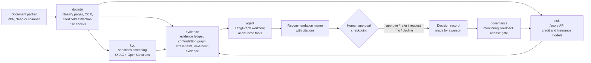

# Underwriting Copilot: evidence-driven underwriting intelligence

An AI underwriting platform for **small-business loans** and **commercial insurance submissions**.

A packet of documents goes in. Out come:

- extracted fields, each with a page citation
- cross-document contradictions (for example, stated revenue vs bank deposits), separated into benign and unsupported
- a sanctions / KYC screening result
- a calibrated risk score with plain-language reason codes
- stress tests: how the risk and the recommendation change if revenue drops, rates rise, or claims increase
- the next piece of evidence worth requesting, ranked by whether it could change the decision
- a recommendation memo and an auditable decision record that **a human must approve**

The copilot never auto-declines. Every decline, sanctions hit, and reconciliation failure goes to a human reviewer.

> **Synthetic data notice.** This is a portfolio project. It uses only public datasets and **synthetic**
> (computer-generated) documents, customers, and news snippets. It contains no real personal data and has no
> production users. Every synthetic artifact is labeled as synthetic.

## Problem

Underwriters spend much of their time reading packets (applications, bank statements, financials, loss runs),
re-keying numbers, checking that the numbers agree, screening names against sanctions lists, and writing up a
recommendation. This project automates the reading and checking, and leaves the decision to a person.

The central question: how can a lender or insurer decide faster while showing that every important conclusion
is supported by evidence, financially justified, consistent with policy, and safe to act on?

The signature component is the **Evidence-to-Action Engine**. It tags every claim as verified, model estimate,
conflicting, or unknown; runs stress scenarios through the risk models; checks whether resolving each open
question would change the recommendation; and recommends the next document to request.

## Architecture



| Package | Phase | Purpose |
|---|---|---|
| `src/uwcopilot/risk` | 1 | Credit-default (Lending Club) and claim frequency/severity (freMTPL2) models, scenario interface, model cards, `/score` API |
| `src/uwcopilot/docintel` | 2 | Synthetic packet generator, OCR, LLM field extraction with citations, deterministic checks, contradiction graph, prompt-injection detection |
| `src/uwcopilot/kyc` | 3 | Watchlist loading, name matching, embedding reranker, adverse-media memo stub |
| `src/uwcopilot/evidence` | 4 | Evidence ledger, financial calculations, stress tests, next-best-evidence ranking, decision records |
| `src/uwcopilot/agent` | 5 | LangGraph agent with a human-approval checkpoint, role-based access, tracing, adversarial evaluation |
| `src/uwcopilot/governance` | 6 | Versioning, monitoring, reviewer feedback, champion/challenger, CI release gate |
| `src/uwcopilot/common` | 0 | Shared helpers (paths, checksums) |

The diagram shows the planned design. Each component is built in the phase listed above; see
[docs/build_prompts.md](docs/build_prompts.md) for the full plan. Until a phase is merged, its component does
not exist yet.

## Datasets and licenses

Raw data is **never committed**. `make data` downloads everything into `data/raw/` and logs a SHA-256 checksum
for each file in `data/raw/checksums.jsonl`.

| Dataset | Used for | Source | License / terms |
|---|---|---|---|
| Lending Club accepted loans 2007-2018 | Credit-default model | Kaggle `wordsforthewise/lending-club` | See the Kaggle dataset page. Needs a Kaggle API key. |
| freMTPL2freq / freMTPL2sev | Insurance claim-frequency model | OpenML [41214](https://www.openml.org/d/41214) / [41215](https://www.openml.org/d/41215) (originally from the CASdatasets R package) | OpenML lists CC0 |
| UCI Statlog German Credit | Fairness demonstration | [UCI ML Repository](https://archive.ics.uci.edu/dataset/144/statlog+german+credit+data) | CC BY 4.0 |
| OFAC SDN list (+ aliases) | Sanctions screening | [US Treasury OFAC](https://www.treasury.gov/ofac/downloads/sdn.csv) | US government public data |
| OpenSanctions "default" (simplified CSV) | Sanctions screening | [OpenSanctions](https://www.opensanctions.org/datasets/default/) | CC BY-NC 4.0. Data from OpenSanctions.org, used non-commercially with attribution. |
| Synthetic packets, customers, news snippets | Document intelligence, KYC, agent evaluation | Generated by scripts in this repo | Synthetic, generated here |

## How to run

Requires Python 3.11 and [uv](https://docs.astral.sh/uv/).

```bash
cp .env.example .env      # add your Kaggle key (and an LLM key from Phase 2 on)
make setup                # install exact versions from uv.lock
make test                 # run the test suite
make data                 # download the public datasets
```

Run `make help` to see every target.

## Results

Every number in this table is generated by a script from `results/*.json`. Nothing is typed by hand.
Rows that have not been run say "not measured".

<!-- RESULTS:START -->
| Component | Metric | Value |
|---|---|---|
| Credit-default model (Lending Club) | Test AUC | not measured |
| Insurance frequency model (freMTPL2) | Mean Poisson deviance | not measured |
| Document extraction | Field F1 | not measured |
| Contradiction detection | Recall | not measured |
| Sanctions screening | Recall at alerts per 1,000 | not measured |
| Evidence-to-Action Engine | Next-best-evidence top-3 accuracy | not measured |
| Agent | Escalation correctness | not measured |
| Agent | Cost and p95 latency per packet | not measured |
<!-- RESULTS:END -->

## Limitations

- Documents, customers, and news snippets are synthetic. Real packets are messier.
- Models are trained on public datasets that may not represent any particular lender's or insurer's portfolio.
- Lending Club has no protected attributes, so the fairness analysis is a demonstration on a different dataset
  (UCI German Credit).
- No production users. Nothing here has been validated for real lending or insurance decisions.
- Business-value numbers, when added, are measured on the synthetic test set against a defined baseline. They
  do not show real-world savings.
- The governance documents show how a model-risk program could be structured. They are not a compliance program.
- The copilot only makes suggestions. A human makes every decision.
