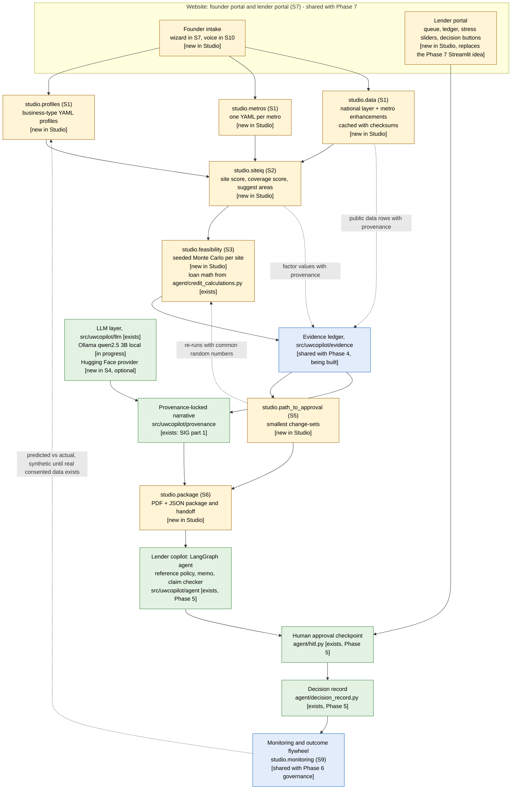

# Founder Studio: architecture and alignment with Underwriting Copilot (Phase S0)

Written on 2026-10-12 for Rahul Vajja and Bhavani Adula. This is a plan. No Studio code exists yet.
The full Studio plan is [founder_studio_build_prompts.md](founder_studio_build_prompts.md). The module-by-module reuse
table is in [reuse.md](reuse.md). Open questions are in [open_questions.md](open_questions.md).

## 1. One product, one repo

Underwriting Copilot today is the **lender's** side. A packet of documents goes in. A cited, stress-tested
recommendation comes out, and a human decides.

Founder Studio adds the **borrower's** side. A founder picks a city, a business type and candidate addresses, and
enters a budget. Studio scores the sites, simulates possible futures, shows what to change to become approvable, and
builds a lender-ready package where every number links to its source. The package goes into the same lender copilot,
where a human still makes every decision.

These are not two projects. They share one repo, one Python package (`uwcopilot`), one evidence ledger, one LLM layer,
one human-approval step, one decision record, one website and one monitoring layer.

### Merge decisions (from the lead engineer, 2026-10-12)

1. One product, one repo, one package `uwcopilot`. Studio code lives in `src/uwcopilot/studio/*`.
2. Studio S4 does **not** build a second ledger. It uses the Phase 4 evidence ledger in `src/uwcopilot/evidence`
   (being built next) and the SIG provenance-locked memo stack in `src/uwcopilot/provenance` (`numbers.py`,
   `numeric_check.py`, `memo_grammar.py`, `renderer.py`, already committed).
3. Studio S7 **is** the Phase 7 website: one Next.js app (static export) served by FastAPI, with a founder portal and
   a lender portal. The lender portal replaces the Streamlit demo that Phase 7 originally suggested.
4. Studio S9 monitoring is shared with Phase 6 governance. Studio S12 is merged with Phase 8 (README, resume lines,
   interview guide).
5. LLM: the local open model qwen2.5 3B (Q4_K_M), served by Ollama, is the working provider in this environment (no
   paid key). The "Hugging Face Inference provider" in S4 is an optional extra behind the same LLM interface.
6. Documents and tests stay synthetic or public-data only. Every CLAUDE.md ground rule still applies.

## 2. Status labels used below

| Label | Meaning |
|---|---|
| **exists** | Committed code in this repo today. It may be only partly built; [reuse.md](reuse.md) says what. |
| **in progress** | In the working tree on 2026-10-12 but not committed yet. Another agent is building it. |
| **shared with Phase N** | Built once and used by both sides. The lender-side Phase N plan owns it; the Studio phase extends it. |
| **new in Studio** | Does not exist. Built in the named Studio phase. |

## 3. Diagram

The text in each box carries its status, so the diagram does not depend on color.



## 4. What each box is

| Box | Where it lives | Status on 2026-10-12 | Built in | Notes |
|---|---|---|---|---|
| Founder intake | web app (S7); intake schema in `src/uwcopilot/studio/` | new in Studio | S7 (S10 adds voice) | Founder text is untrusted data (ground rule 8). It is screened and escaped, and never chooses tools or calculations. |
| studio.profiles | `src/uwcopilot/studio/profiles`, `config/studio/business_types/*.yaml` | new in Studio | S1 | Every numeric field is SOURCED (with a primary source) or ASSUMPTION (range, user-editable). See [business_types.md](business_types.md). |
| studio.metros | `src/uwcopilot/studio/metros`, `config/studio/metros/*.yaml` | new in Studio | S1 | One YAML per metro. Adding a metro is one file plus a coverage report. See [metros.md](metros.md). |
| studio.data | `src/uwcopilot/studio/data` | new in Studio | S1 | One connector per source. Each returns values plus a provenance record. See [data_sources.md](data_sources.md). |
| studio.siteiq | `src/uwcopilot/studio/siteiq` | new in Studio | S2 | `score_site` and `suggest_areas`. Every result carries a data-coverage score. |
| studio.feasibility | `src/uwcopilot/studio/feasibility` | new in Studio | S3 | Seeded NumPy simulation. Loan payments use `agent/credit_calculations.py`. |
| Evidence ledger | `src/uwcopilot/evidence` | shared with Phase 4; only `__init__.py` exists | Phase 4, extended by S4 | One ledger for both sides. Studio adds two statuses (section 6). |
| Provenance-locked narrative | `src/uwcopilot/provenance` | exists (SIG part 1, commit 5bbfa4d); `evaluation.py` in progress | SIG, extended by S4 | The LLM writes slots; the renderer fills numbers from the ledger. |
| LLM layer | `src/uwcopilot/llm` | exists; the Ollama client is in progress | GenAI track, S1 innovation, S4 | One `LLMClient` protocol, cost cap, cache. A Hugging Face provider is optional and new in S4. |
| studio.path_to_approval | `src/uwcopilot/studio/path_to_approval` | new in Studio | S5 | Plan choices only. Never suggests changing a fact. |
| studio.package | `src/uwcopilot/studio/package` | new in Studio | S6 | PDF + JSON. Converts the package into the agent's application input. |
| Lender copilot (agent) | `src/uwcopilot/agent` | exists (Phase 5) | Phase 5 | Takes one application JSON today. See the gaps in section 8. |
| Human approval | `src/uwcopilot/agent/hitl.py` | exists (Phase 5) | Phase 5 | The only place a decision is made, and only by a person. |
| Decision record | `src/uwcopilot/agent/decision_record.py` | exists (Phase 5) | Phase 5 | Append-only, hash-chained JSONL. |
| Website | Next.js static export + FastAPI | new; shared with Phase 7 | S7 = Phase 7 A | Founder portal and lender portal in one app. |
| Monitoring | `src/uwcopilot/studio/monitoring` + `src/uwcopilot/governance` | new; shared with Phase 6 | S9 = Phase 6 B/C | Drift of actuals vs projection bands, plus model and LLM monitoring. |

## 5. Innovations I1-I8 and where each lives

| # | Innovation | Where it lives | Phase | Depends on | Status today |
|---|---|---|---|---|---|
| I1 | Provable numbers (evidence-linked package) | `src/uwcopilot/evidence` (ledger), `src/uwcopilot/provenance` (grammar, renderer, checker), `studio.package` (evidence appendix) | S4 (= Phase 4 + SIG), S6 | Phase 4 ledger | Provenance stack exists; ledger not built |
| I2 | Site-level Monte Carlo feasibility | `studio.feasibility` | S3 | S1 profiles and data, S2 demand estimate | Not built |
| I3 | Path to approval (counterfactual search) | `studio.path_to_approval` | S5 | S3 simulator | Not built |
| I4 | "Suggest a better area" | `studio.siteiq.suggest_areas` | S2 | S1 tract data for the metro | Not built |
| I5 | Two-sided handoff | `studio.package` handoff, `src/uwcopilot/agent`, lender portal | S6, S7 (= Phase 7) | Phase 5 agent, the startup-policy gap (section 8) | Agent exists; handoff not built |
| I6 | After-funding monitoring and outcome flywheel | `studio.monitoring`, `src/uwcopilot/governance` | S9 (= Phase 6) | First deployment; consented data rules (S8) | Not built |
| I7 | Voice intake (later) | web app + an interview agent that can only write intake fields | S10 | S7 wizard, a speech-to-text provider | Not built; Hugging Face is blocked here, so it cannot run in this environment |
| I8 | Multi-city data fabric with honest coverage | `studio.metros`, `studio.data`, `scripts/studio_metro_coverage.py` | S1 | Network access to the data hosts | Not built; every data host is blocked here (see [data_sources.md](data_sources.md)) |

## 6. Contracts between the boxes

**From data to ledger.** Every value Studio shows becomes one ledger claim. The status says where it came from:

| Where the value comes from | Ledger status | Provenance it must carry |
|---|---|---|
| A public dataset row (Census, BLS, OSM ...) | VERIFIED | publisher, dataset or table, URL, row or geography id, request date, snapshot date, SHA-256 of the cached response, metro id |
| A founder's uploaded document with a locator (a quote, a lease letter) | VERIFIED | document id, page, line |
| A founder's typed input | USER_STATED | intake field, timestamp |
| The simulator or SiteIQ | MODEL_ESTIMATE | distribution summary, simulator or scorer version, seed, input hash |
| A profile or metro range | ASSUMPTION | the range, and its source or the word "unsourced" |
| Two sources that disagree | CONFLICTING | links to both claims |
| Needed but absent | UNKNOWN | the reason |

**One ledger, a wider status list.** The Phase 4 spec has four statuses: VERIFIED, MODEL_ESTIMATE, CONFLICTING and
UNKNOWN. Studio S4 adds USER_STATED and ASSUMPTION. This is an extension of the shared ledger, not a second ledger.
The Phase 4 builder and the S4 builder must agree on it. The renderer then needs a display suffix for the two new
statuses (today `renderer.STATUS_SUFFIX` covers only CONFLICTING and MODEL_ESTIMATE).

**Narrative.** The LLM writes the plan's prose with `{{claim:ID}}` and `{{assert:ID}}` slots only.
`memo_grammar.validate` rejects digits, number words, currency and percent symbols, unslotted comparatives and decision
wording. `renderer.render` fills every value from the ledger, and `renderer.round_trip_audit` re-checks the result.
If the model's draft stays invalid, a deterministic template is used. So Studio works with no LLM at all.

**Handoff.** `studio.package` turns the package into the application JSON the agent reads, plus the ledger. The agent
runs its reference policy and stops at the human checkpoint. The lender sees the founder's ledger with every
ASSUMPTION and UNKNOWN marked.

## 7. Safety boundaries (all reuse existing rules)

- **No decisions.** Studio prepares and explains. It never approves, declines, promises approval or recommends a
  specific lender (addendum rule C). On the lender side, a decision is made only by a person, through
  `agent/hitl.validate_decision`, and written by `DecisionLog`.
- **No approve or decline tool.** Any tool Studio adds to `tools/registry.ALLOWED_TOOLS` is read-only.
- **Untrusted text.** Founder descriptions and uploads are data, never instructions (ground rule 8). They go through
  the existing tripwire (`agent/injection.detect`) and are escaped in prompts (`rag/prompt.escape_text`).
- **Numbers come from code.** The LLM never types a number in a founder plan or a lender memo.
- **Probabilities are labeled** "simulated, based on stated assumptions" (addendum rule E).
- **Disclaimer on every results page:** "Educational planning tool. Not financial, legal or lending advice. Lenders
  make their own decisions."
- **Synthetic only in the repo.** Tests, fixtures and evaluations use public or SYNTHETIC data, labeled SYNTHETIC.

## 8. What does not exist yet (plain list)

Details and the exact functions are in [reuse.md](reuse.md).

1. **The evidence ledger.** `src/uwcopilot/evidence` holds only `__init__.py`. Phase 4 builds it next.
2. **A policy for new businesses.** The reference policy (`agent/policy.py`, SYNTHETIC Northwind guideline) is written
   for operating businesses. It needs a full run of bank statements to verify revenue, and it has minimum
   time-in-business rules. A pre-revenue founder file would always be routed to "request more information" or
   "refer". S6 needs an owners' decision on this (see [open_questions.md](open_questions.md)).
3. **Application fields for a startup.** `CreditApplication` (`agent/applications.py`) forbids unknown fields and has
   no projection fields. Its SYNTHETIC industry list has codes for a bakery, a full-service restaurant and a hardware
   retail store, but none for a car wash, motel, short-term rental or laundromat.
4. **Applicable risk models.** The Phase 1 models are a consumer credit model (Lending Club, not trained here because
   there is no Kaggle key) and a French motor insurance model (freMTPL2). Neither applies to a founder's business.
   Studio does not call `/score` for founder files; any model-PD claim is UNKNOWN with that reason.
5. **A working risk client.** `risk/client.py` and `risk/service.py` disagree on the request and response schema, so
   the client cannot get a successful score today (documented in the Phase 1 code map; a fix is planned in the
   Phase 5 additions).
6. **Revenue and rate stress levers in `risk/scenario.py`.** That module overrides Phase 1 model inputs. The loan
   stress levers live in `agent/policy_credit.py` (fixed revenue and rate shocks) and in the planned Phase 4
   `evidence/scenarios.py` (a grid of shocks).
7. **Roles for the website.** `agent/hitl.py` knows two roles: `underwriter` and `senior_underwriter`. S7 needs
   `founder`, `lender_reviewer`, `lender_senior` and `admin`. Proposal: map `lender_reviewer` to `underwriter` and
   `lender_senior` to `senior_underwriter`; `founder` and `admin` can never decide. Phase 5 additions plan an
   authorization module for this.
8. **A Hugging Face LLM provider.** The LLM layer has `anthropic`, `openai`, `ollama` and `fake`. Hugging Face is
   blocked in this environment, so an S4 Hugging Face provider could only be tested with mocked HTTP here, and the
   docs must say it was never run.
9. **Any Studio data.** Every Studio data host is blocked in this environment (checked 2026-10-12). See
   [data_sources.md](data_sources.md).
10. **Geospatial and web dependencies.** `uv.lock` has NumPy, SciPy, FastAPI, httpx and reportlab, but no geospatial
    library (shapely, pyproj, geopandas are not in the lock), no Supabase or Stripe client, and CI has no Node
    toolchain for the Next.js app. Each one is added in the phase that needs it, with the lockfile in the same
    commit.

## 9. Merged phase map

Lender phases are from [docs/build_prompts.md](../build_prompts.md). Studio phases are from
[founder_studio_build_prompts.md](founder_studio_build_prompts.md). Shared rows are built once.

| Step | Scope | Shared with | Status on 2026-10-12 |
|---|---|---|---|
| Phase 0 | Repo setup, lockfile, CI | - | Done |
| Phase 1 | Risk models, scenario interface, `/score` | Studio reuses the bootstrap, PSI and override-validation helpers, not the models | Built; credit model not trained (no Kaggle key) |
| Phase 2 | Document intelligence | S8 reuses its injection scan and text normalization for founder uploads | In progress |
| Phase 3 | KYC / sanctions screening | The lender side can screen names at handoff (S6) | Built |
| Phase 4 | Evidence-to-Action Engine, ledger, decision records | **= S4.** One ledger for both sides | Next; SIG part 1 committed |
| Phase 5 | Agent, human approval, security | S6 hands packages to this agent; S8 reuses its planned security modules | Built; additions planned |
| Phase 6 | Governance, monitoring, release gate | **= S9** monitoring | In progress (provenance block in the working tree) |
| Phase 7 | UI, business value, deployment | **= S7** website (lender portal replaces Streamlit); deployment = S11 | Not started |
| Phase 8 | README, resume lines, interview guide | **= S12** | Not started |
| v2.1 innovations | SIG and items "S1"-"S6" in [innovations.md](../innovations.md) | SIG is the base of the S4 narrative | SIG part 1 committed; others in progress |
| Studio S0 | This alignment (docs only) | - | This change |
| Studio S1 | Profiles, metros, data fabric | - | Not started; real data needs network access |
| Studio S2 | SiteIQ and "suggest a better area" | - | Not started |
| Studio S3 | Feasibility simulator | Reuses `agent/credit_calculations.py` | Not started |
| Studio S4 | Ledger + locked narrative | **= Phase 4 + SIG** | Waiting for Phase 4 |
| Studio S5 | Path to approval | - | Not started |
| Studio S6 | Package + handoff | Phase 5 agent | Not started; blocked by the startup-policy gap |
| Studio S7 | Website | **= Phase 7 A** | Not started |
| Studio S8 | Privacy and security | Phase 5 B security | Not started |
| Studio S9 | Monitoring | **= Phase 6 B/C** | After the first deployment |
| Studio S10 | Voice intake | - | Later |
| Studio S11 | Deploy to a Hugging Face Space | **= Phase 7 C** (the hosting decision in the Studio plan) | Not started |
| Studio S12 | Evaluation, README, resume lines | **= Phase 8**, plus Phase 7 B business value | Not started |

**Name clash.** [innovations.md](../innovations.md) already uses "S1" to "S6" for innovation items (for example "S1 -
Local-model generation eval"). In this document "Studio S1" means the Studio phase. Proposal: write "innovation S1"
and "Studio S1" in commit messages and docs.

**Order.** The Studio plan's order is S1, S2, S3, S4, S5, S6, S7, S8, S11, S12, with S9 and S10 after the first
deployment. S4 cannot finish before Phase 4 has a ledger. S6 cannot finish before the startup-policy decision.

## 10. Where the code will go (proposal, decided in each phase)

```
src/uwcopilot/studio/
    profiles/          S1  Pydantic models + YAML loader for business-type profiles
    metros/            S1  metro configs and the coverage threshold ("limited mode")
    data/              S1  one connector per source, cache with SHA-256, provenance records
    siteiq/            S2  score_site, suggest_areas, synthetic-city validation
    feasibility/       S3  simulate(), loan schedule (reusing agent/credit_calculations.py)
    path_to_approval/  S5  find_paths()
    package/           S6  PDF + JSON package, conversion to the agent's application input
    monitoring/        S9  actuals vs projection bands (with governance/)
config/studio/
    business_types/*.yaml
    metros/*.yaml
```

The location of the Next.js source and the FastAPI app is decided in S7.
