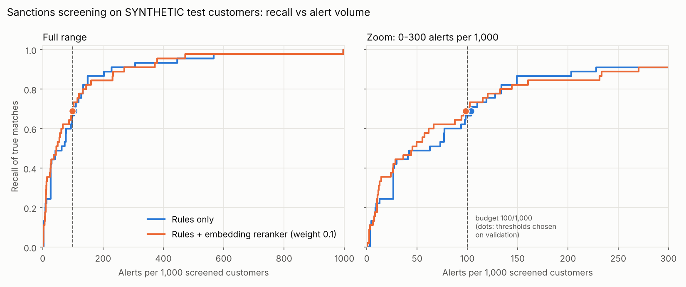

# Phase 3 walkthrough: KYC / sanctions screening

Phase 3 screens a customer name (a business or its owner) against two public watchlists, the US Treasury OFAC
SDN list and the OpenSanctions "default" collection, and returns either `clear` or `potential_match`. A potential
match always goes to a human compliance reviewer with an explanation. Nothing in the code can clear, dismiss
or confirm a match.

Everything was run for real on this machine: the full watchlists (no subsampling), 5,300 SYNTHETIC customers,
and the `sentence-transformers/all-MiniLM-L6-v2` embedding model through fastembed (ONNX Runtime). No LLM was
called. The adverse-media memo is a stub tested with a fake LLM, so its quality is **not measured (no LLM key)**.

Not done in this phase:
- Prompt 3 part F, adding screening results as nodes of the Phase 2 evidence graph. That graph does not exist on
  this branch yet.

The README results table now has the screening rows, written by `make readme-results`
(`scripts/update_readme_results.py`) from `results/kyc_metrics.json`.

## How one name is screened

```
customer name, type, country
        |
   normalize        "Dr. Mohamed Aly Hasan"  ->  tokens (mohamed, aly, hasan), stripped: dr
        |
   block            ~2.5 million list names  ->  at most 3,000 candidates
        |           (token keys: exact token, Double Metaphone code, character 3-grams; first-token block)
   pre-rank         rapidfuzz in C++ (token_set + token_sort) keeps the best 300 names
        |
   rules score      token-aligned Jaro-Winkler + token-set ratio + small type/country adjustment
        |           best name per list entry; top 10 entries go on
   rerank           optional: blend with embedding cosine (all-MiniLM-L6-v2, ONNX)
        |
   alert            score >= threshold (chosen on validation)  ->  potential_match + explanation
                    otherwise clear. Every result carries the list snapshot checksums.
```

## Files

| File | What it does | Why it is built this way |
|---|---|---|
| `src/uwcopilot/kyc/watchlist.py` | Loads OFAC `sdn.csv` (no header, `-0-` means empty) with `alt.csv` aliases, and OpenSanctions `targets.simple.csv` (only the 7 needed columns, via `usecols`). Produces one table: `list_entry_id, name, aliases, entity_type, countries, programs, source, source_id, list_name`. Hashes each file and looks up its first date in `data/raw/checksums.jsonl`, giving a `ListSnapshot` per file. | One table means one matcher for both sources. Snapshots go into every result, so an alert can be traced to the exact list version. OpenSanctions' FollowTheMoney `LegalEntity` can be a person or a company, so it maps to `other` (type unknown) rather than guessing. |
| `src/uwcopilot/kyc/normalize.py` | Unicode NFKD with accents dropped, `casefold()`, apostrophes removed, other punctuation turned into spaces. For people it strips leading honorifics ("Dr.", "Sheikh") and trailing suffixes ("Jr.", "PhD"). For everything else it joins dotted abbreviations ("S.A." -> `sa`) and strips legal forms ("LLC", "GmbH", leading "OOO", "Joint Stock Company"). | Spelling noise that carries no identity is removed before any comparison, on both sides in the same way. The stripped words are recorded so the explanation can show them. A name is never stripped to nothing. |
| `src/uwcopilot/kyc/countries.py` | Maps ISO codes and the country names found in OFAC remarks ("nationality Iran", "Korea, North") to lowercase ISO alpha-2 codes. | OpenSanctions uses codes and OFAC uses English names. An unknown name stays as text and is never guessed. |
| `src/uwcopilot/kyc/blocking.py` | A token-level inverted index over every list name: vocabulary, posting lists stored as compressed numpy arrays, a Double Metaphone index, a character 3-gram index over the vocabulary, and a first-token index. `candidates()` returns name ids, vote counts, and the candidate-set size before and after the cap. | Comparing every customer with 2.5 million names is too slow. Indexing distinct tokens instead of whole names keeps the 3-gram index small, and numpy marks and counts votes over millions of names in milliseconds. |
| `src/uwcopilot/kyc/scoring.py` | Token-aligned (Monge-Elkan) Jaro-Winkler in both directions, rapidfuzz `token_set_ratio`, the type/country adjustment, the rescaling to [0, 1], and the explanation sentences: matched tokens, phonetic agreement, list tokens left unmatched. | Each piece handles a different kind of noise (see design choices). The explanation is built from the same comparisons that produced the score, so it cannot drift from it. |
| `src/uwcopilot/kyc/reranker.py` | `FastEmbedEmbedder` (all-MiniLM-L6-v2 through fastembed and ONNX Runtime, cached in `.cache/models`), `HashingEmbedder` (an offline stand-in for tests), cosine similarity, and `blend()`. | fastembed runs the same MiniLM weights exported to ONNX, without PyTorch. This replaces the torch `sentence-transformers` package named in the build plan. Only the top 10 candidates are embedded. |
| `src/uwcopilot/kyc/matcher.py` | `SanctionsMatcher`: normalize, block, pre-rank, score, rerank, then `screen()` builds the `ScreeningResult` (from `tools/schemas.py`) with explanations and list snapshots. | One class owns the pipeline; every stage's size and time is kept on `MatchOutcome` so the evaluation can measure each stage. |
| `src/uwcopilot/kyc/screening.py` | `screen(request)` and `screen_entity(request)`, the handler the tool registry already points to. Builds the full matcher on first use with the operating point stored in `results/kyc_metrics.json`. | If no validated threshold exists, it refuses (`ScreeningNotConfigured`) instead of guessing one. The embedding model loads only if the selected operating point uses it. |
| `src/uwcopilot/kyc/evaluation.py` | Threshold choice at an alert budget, recall-vs-alerts curves, screening metrics, 1,000-resample bootstrap intervals (seed 42), and the paired bootstrap of the recall difference. | Plain numpy, unit-tested on hand-computed examples. |
| `src/uwcopilot/kyc/synthetic.py` | SYNTHETIC customers: clean names from Faker, true matches made by adding noise to real list names, hard negatives made by changing part of a list name. Includes the collision check, the exact-name namesakes it sets aside, and the stratified split. | All the logic lives in the package so it can be unit-tested; the script only loads the data and writes files. |
| `src/uwcopilot/kyc/memo.py` | The adverse-media memo stub: SYNTHETIC snippets from fictional outlets, prompt building with snippets as escaped, delimited untrusted data, citation checks, and decision-wording checks. `disposition` is fixed to `pending_human_review`. | Ground rule 8: retrieved text is data. Even if a model obeyed an injected instruction, the result could not clear anyone; it would be flagged as unusable. |
| `scripts/make_kyc_customers.py` | Writes `data/processed/kyc/customers.csv`, `homonyms.csv` (the exact-name namesakes) and `generation_report.json` (gitignored). | `make kyc-data`. Seed 42. |
| `scripts/eval_kyc.py` | Screens all 5,300 customers once, picks the reranker weight on train and thresholds on validation, reports test metrics, scores the namesake stratum separately, and writes `results/kyc_metrics.json`, `results/figures/kyc_recall_vs_alerts.png`, `data/processed/kyc/screening_scores.csv` and `homonym_scores.csv`. | `make eval-kyc`. Every number in this document comes from that JSON file. |
| `tests/kyc/` | 79 offline unit tests on tiny hand-written fixtures (`kyc_fixtures.py`): normalization, countries, watchlist parsing, blocking, scoring, explanations, matcher, threshold choice and bootstrap, synthetic generation (including a check that output does not depend on Python's hash seed), memo prompt injection, the screening tool through the registry, and the script helpers. `test_kyc_integration.py` is marked `integration` and runs on the real lists. | No test needs `data/raw` or a model download, so CI stays offline. |
| `Makefile` | `kyc-data` and `eval-kyc` targets. | Ground rule 3: every step has a target. |

## Data

**Watchlists.** OFAC SDN (`sdn.csv` + `alt.csv`) and OpenSanctions `targets.simple.csv`. OpenSanctions data is
licensed CC BY-NC 4.0, so this project attributes it ("Data from OpenSanctions.org") and uses it only for this
non-commercial demonstration. Commercial use would need an OpenSanctions data license. The OFAC list is US
government public data. Nothing from `data/raw` is committed.

The OpenSanctions "default" collection is much more than sanctions. Besides sanctions lists it contains
politically exposed persons (PEPs), US debarment and healthcare-exclusion lists, wanted-person lists and
registry data. Its `program_ids` column is not a clean sanctions flag either: for example, it is filled for
the US HHS Inspector General exclusions. The whole file was screened (scope "full"), and the results show
what that does to alert volume.

**SYNTHETIC customers** (seed 42, labeled SYNTHETIC in every row, ids `SYN-KYC-*`):
- **clean.** Faker people and businesses. Locales are en_US 70%, es_MX 10%, and en_GB, de_DE, fr_FR, it_IT 5%
  each. Half of the businesses come from Faker's `company()`; the other half are composed, like "Summit Dental
  Ltd". A clean name whose normalized, token-sorted form equals any list name is dropped from the clean group
  and counted as a collision. Each distinct collision is kept in `homonyms.csv` as an **exact-name namesake**:
  a made-up customer who shares a listed name. Keeping them draws no extra random numbers, so the customer file
  is byte-identical with or without them. The namesakes are in no split and are scored as a separate stratum
  (see Results), with no country.
- **true_match.** A real list name (half OFAC, half OpenSanctions entries that carry a program id; half people,
  half organizations; 30% of the time an alias) with one to three noise operations: transliteration swaps
  ("mohammed" -> "muhammad", "ph" -> "f"), one typo, an initial, token reordering, an honorific, or a different
  legal suffix. The source entry is the ground truth.
- **hard_negative.** A different identity deliberately close to a list name. For a person, one name part is
  replaced by a different-sounding name with the same first letter ("Janet Sue Peterson" -> "Janet Louis
  Peterson"). For an organization, about half the words are replaced while the longest word is kept
  ("Elessa Group" -> "Elessa Bakery").
- **split.** Train/validation/test is 40/30/30, stratified by label.

Countries are part of the synthetic design and favor the matcher a little. Clean customers are 85% "US". True
matches carry the list entry's country half the time, and hard negatives 40% of the time. The
country adjustment is small (+0.03 / -0.02 before rescaling).

## Results

All numbers below are copied from `results/kyc_metrics.json` (written by `make eval-kyc`). They are rounded to three decimals (alerts per 1,000 to one); square brackets are 95% bootstrap intervals (1,000 resamples of the test customers, seed 42). The test split has 1,500 clean customers, 45 true matches and 45 hard negatives, so the recall intervals are wide.

### Scope and data

- Watchlist entries screened: 1,260,225 (OFAC 19,416; OpenSanctions 1,240,809). Entries dropped: 0 OFAC and 0 OpenSanctions (only empty names would be dropped). No subsampling.
- Indexed names (primary names plus aliases, de-duplicated per entry after normalization): 2,497,215; distinct tokens: 1,076,680.
- Entity types: person 1,038,439, organization 117,155, other 93,312, vessel 10,635, aircraft 684.
- List snapshots (SHA-256, first recorded date in `data/raw/checksums.jsonl`):
  - OFAC `sdn.csv`: `64be7a7991059f59a2ebb43bc5dcc7e2951e1e27cbed8cbe41b0231b3a161946` (2026-10-10)
  - OFAC `alt.csv`: `ff6075fc9635c5034475fa49c0c2e0e03300e1c9375771d75f99c4d4bf799c1b` (2026-10-10)
  - OpenSanctions `targets.simple.csv`: `99854904a7059e7309765d2bd2951041279c509f1b67eb0deb0af8894fdea16d` (2026-10-10)
- SYNTHETIC customers: 6,240 clean names generated, 746 dropped as exact list collisions and 494 as duplicates, 5,000 kept; 150 true matches; 150 hard negatives (different_surname 23, different_given_name 52, different_words 75; 0 dropped for list collisions). Customer file SHA-256 `d1a2e311d55ef3aa2c7271e31c211e84a7e5d53743319ac032db2fc3ffa42e44`.
- Exact-name namesakes (the 746 collisions, de-duplicated): 648, scored separately below.

### Choosing the reranker weight (train) and the operating point (validation)

| Reranker weight | Train threshold at 100/1,000 | Train recall |
|---|---|---|
| 0.1 | 0.930 | 0.667 |
| 0.2 | 0.921 | 0.650 |
| 0.3 | 0.916 | 0.583 |
| 0.4 | 0.910 | 0.583 |
| 0.5 | 0.905 | 0.567 |

Chosen weight: 0.1. On validation at 100 alerts per 1,000, rules-only reached recall 0.511 (threshold 0.948) and rules+reranker 0.511 (threshold 0.931). Selected operating point: **rules_only**, threshold 0.9483, reranker weight 0.0. The rule: rules+reranker is selected only if its validation recall at the primary budget is strictly higher than rules-only; otherwise the simpler rules-only matcher is used. This is the configuration `screen()` uses.

### Test metrics (thresholds chosen on validation)

| Budget (alerts/1,000) | Method | Threshold | Recall | Alerts per 1,000 | Precision | Hard-negative FP rate | Clean FP rate |
|---|---|---|---|---|---|---|---|
| 50 | rules_only | 0.961 | 0.489 [0.340, 0.629] | 56.6 [45.3, 67.9] | 0.244 [0.157, 0.330] | 0.000 [0.000, 0.000] | 0.045 [0.035, 0.057] |
| 50 | rules_plus_reranker | 0.949 | 0.578 [0.439, 0.721] | 60.4 [49.7, 71.7] | 0.271 [0.184, 0.356] | 0.022 [0.000, 0.073] | 0.046 [0.036, 0.057] |
| 100 | rules_only | 0.948 | 0.689 [0.548, 0.818] | 103.8 [89.9, 118.9] | 0.188 [0.131, 0.250] | 0.022 [0.000, 0.073] | 0.089 [0.076, 0.103] |
| 100 | rules_plus_reranker | 0.931 | 0.689 [0.543, 0.821] | 98.1 [84.9, 112.6] | 0.199 [0.138, 0.263] | 0.022 [0.000, 0.073] | 0.083 [0.070, 0.097] |
| 200 | rules_only | 0.928 | 0.867 [0.762, 0.955] | 172.3 [154.7, 191.8] | 0.142 [0.102, 0.186] | 0.022 [0.000, 0.073] | 0.156 [0.139, 0.176] |
| 200 | rules_plus_reranker | 0.908 | 0.844 [0.733, 0.932] | 191.2 [172.3, 210.7] | 0.125 [0.089, 0.163] | 0.067 [0.000, 0.152] | 0.175 [0.157, 0.195] |

Paired bootstrap of recall(rules+reranker) minus recall(rules-only) on the same test resamples:

| Budget | Difference | 95% interval | Share of resamples where the reranker is higher | Share equal |
|---|---|---|---|---|
| 50 | +0.089 | [+0.000, +0.196] | 0.943 | 0.037 |
| 100 | +0.000 | [-0.067, +0.064] | 0.363 | 0.319 |
| 200 | -0.022 | [-0.075, +0.000] | 0.000 | 0.358 |



The figure (`results/figures/kyc_recall_vs_alerts.png`) shows the full recall-vs-alerts curve of both methods on the test split; the dots are the operating points whose thresholds were chosen on validation for the 100 per 1,000 budget. The curve itself is descriptive: reading a better threshold off it would be tuning on test.

### Blocking

Blocking recall is the share of true matches whose source list entry is still a candidate after a stage.

| Stage | Test (n=45) | All splits (n=150) |
|---|---|---|
| Blocking, before the 3,000-name cap | 0.978 [0.933, 1.000] | 0.993 [0.980, 1.000] |
| Blocking, after the cap | 0.956 [0.889, 1.000] | 0.987 [0.967, 1.000] |
| Pre-rank (top 300 names) | 0.956 [0.889, 1.000] | 0.987 [0.967, 1.000] |
| Top 10 entries (the reranked set) | 0.956 [0.889, 1.000] | 0.987 [0.967, 1.000] |

Candidate-set size per customer (all 5,300 customers) out of 2,497,215 indexed names: before the cap mean 10,133, median 5,857, 95th percentile 33,488, max 99,688; after the cap mean 2,150, median 3,000. The cap applied to 61.6% of customers; 0.3% had no candidate at all.

### Where recall is lost and where false alerts come from (selected operating point, test)

| Noise operation (a name can have several) | True matches | Alerted |
|---|---|---|
| transliteration | 14 | 5 |
| typo | 20 | 13 |
| initials | 5 | 1 |
| token_reorder | 12 | 10 |
| honorific | 13 | 10 |
| suffix_change | 9 | 5 |

Alerted clean test customers: 133. Source of the best-scoring list entry: OpenSanctions 133. First dataset named on that entry (top 8):

- US Health and Human Services Inspector General Exclusions: 43
- US California Medicaid Suspended and ineligible providers: 21
- PEP position annotations by OpenSanctions: 14
- Wikidata: 9
- US SAM Procurement Exclusions: 7
- MySociety's EveryPolitician Legislators: 6
- US FINRA Barred Individuals: 6
- US Periodically Listing Updates to Management (PLUM: 3

### Exact-name namesakes (separate stratum)

These 648 SYNTHETIC customers have a made-up name that, after normalization, is exactly a list name (746 of the
6,240 generated clean names, 0.120, were such collisions before de-duplication). They were never in train,
validation or test, so nothing was tuned on them. A name-only screener *should* alert on them: only a human with
secondary identifiers can tell a namesake from the listed party. They show the alert volume that the clean group
leaves out.

| Threshold (chosen on validation) | Alerted | Alert rate |
|---|---|---|
| rules_only 0.961 (budget 50) | 487 of 648 | 0.752 [0.718, 0.782] |
| **rules_only 0.948 (budget 100, selected)** | 509 of 648 | 0.785 [0.755, 0.815] |
| rules_only 0.928 (budget 200) | 519 of 648 | 0.801 [0.772, 0.830] |
| rules_plus_reranker 0.908 (budget 200) | 648 of 648 | 1.000 [1.000, 1.000] |

At the selected point every person namesake alerted (480 of 480), but only 29 of 168 organization namesakes did.
Most organization namesakes are one-word business names (a surname plus a legal form, "<Surname> LLC") whose
remaining token equals a one-word alias of a listed *person* (in the entries checked by hand, a bare surname
recorded as an alias of a politically exposed person). The entity-type check lowers their score below the threshold. That is the intended behaviour of the type
adjustment, but it also means an organization named after a listed person is screened mostly on its name tokens.

### Example alert (selected configuration)

SYNTHETIC customer SYN-KYC-05048, derived from a public OFAC SDN organization entry, screened as `Lizingovaya
Kompaniya Kamwaz` (organization, country FR). The example is picked from organization true matches only, so the
results file names no listed individual. Top candidate `OFAC-37757` (OFAC SDN (RUSSIA-EO14024)), matched name
`LIZINGOVAYA KOMPANIYA KAMAZ PAO`, score 0.9598. Explanation, as returned:

```
customer name normalized to 'lizingovaya kompaniya kamwaz'
matched alias 'LIZINGOVAYA KOMPANIYA KAMAZ PAO' of list entry 'LEASING COMPANY KAMAZ INCORPORATED'
matched tokens: 'lizingovaya' = 'lizingovaya' (exact); 'kompaniya' = 'kompaniya' (exact); 'kamwaz' ~ 'kamaz' (same Double Metaphone code KMS, Jaro-Winkler 0.96)
phonetic agreement: 3 of 3 customer tokens share a Double Metaphone code
entity type agrees: both organization (+0.02)
country not compared: unknown on the list entry or the customer
scores: token-aligned Jaro-Winkler 0.987, token-set ratio 0.982, rules score 0.960, final 0.960 (alert threshold 0.948)
list: OFAC SDN (RUSSIA-EO14024); programs: RUSSIA-EO14024
potential match only: a human compliance reviewer must decide; this system never clears or confirms a match
```

Every result also lists the list snapshots it was screened against. The OpenSanctions snapshot carries the
attribution "Data from OpenSanctions.org, licensed CC BY-NC 4.0", so the attribution travels with any result
that contains OpenSanctions names (for example through the MCP `screen_sanctions` tool).

### Runtime

- Rules stage (normalize, block, pre-rank, score): 19.7 s per 1,000 customers.
- Rerank stage (embedding the top candidates, 2 ONNX threads): 11.9 s per 1,000 customers.
- Total 31.6 s per 1,000 customers. One-off costs: watchlist load 22 s, index build 43 s; peak memory 2,258 MB.
- The metrics are deterministic; only these timings change between runs on a shared machine.
- Conditions: single process, wall-clock on a shared 4-CPU machine with another job running; rules stage = normalize + block + pre-rank + rules score; rerank stage = embedding the top candidates (cached per distinct text, so repeated list names are embedded once).

### Adverse-media memo

Memo quality: **not measured (no LLM key)**; the memo prompt builder and citation checks are unit-tested with a fake LLM only.

## Design choices

- **Normalize, then compare.** Honorifics, legal forms, accents, case and punctuation carry no identity. Removing
  them on both sides first means the scorers only see differences that matter. For a person, "Dr." is
  stripped; for a company, "General" is kept, because "General Dynamics" is a name. That is why the entity type
  decides which word lists apply.
- **Blocking at token level, with votes.** Each customer token pulls in similar list tokens through three keys.
  - Exact token, the cheapest key.
  - Double Metaphone codes, for transliteration: "mohammed", "muhammad" and "mohamad" all become `MHMT`.
  - Character 3-gram Dice of at least 0.5, for typos.
  
  A list name is a candidate when at least half of the customer's tokens found a similar token in it, or when
  it starts with the customer's first token. Initials do not create candidates: an "M" would pull in a large
  share of the list. Tokens of two letters ("al", "de") match exactly or not at all. With common tokens the
  candidate set can reach tens of thousands, so it is capped at 3,000 names. The names kept are the ones with
  the most votes, then first-token agreement, then the closest token count. Both sizes and the recall before
  and after the cap are reported.
- **Why two scorers.**
  - Jaro-Winkler rewards a shared start and tolerates small typos, but on a whole string it is sensitive to
    word order. It is therefore applied token by token: each token is paired with its best counterpart
    (Monge-Elkan), in both directions, and the two averages are averaged. Running it in both directions stops
    "Smith" from matching every longer name that contains "Smith".
  - `token_set_ratio` compares shared and leftover tokens as sets, so an extra middle name costs little.
  
  The weights are 0.6 and 0.4. They were fixed as design choices, not tuned on test data.
- **Attributes nudge; names decide.** Entity type agreement adds 0.02 and disagreement subtracts 0.05. A
  person is not a vessel, so disagreement is stronger evidence. Country agreement adds 0.03 and disagreement
  subtracts 0.02, because people move and hold several nationalities. The sum is rescaled linearly from
  [-0.07, 1.05] to [0, 1]. Clipping at 1.0 instead would tie many near-identical names at exactly 1.0, and
  ties at the top make a threshold impossible to place within a budget. This change was found on a
  validation sample during development.
- **Pre-rank before the Python scorer.** rapidfuzz scores all 3,000 candidates in C++ (mean of
  `token_set_ratio` and `token_sort_ratio`) and keeps 300. The token-aligned scorer then runs on those 300 in
  plain Python, which keeps the code readable.
- **Embedding reranker on the top 10 only.** The final score is `(1 - w) * rules + w * cosine`. Here `w` is
  picked on the train split from 0.1 to 0.5, and `w = 0` is the rules-only baseline. The production
  configuration uses the reranker only if its validation recall at the primary budget is strictly higher than
  rules-only. The simpler system wins ties.
- **Threshold objective.** Maximize recall of true matches subject to an alert budget, in alerts per 1,000
  screened customers. Alerts cost analyst time; missed matches cost much more. The budget turns that trade-off
  into one number an operations team can staff for. The budgets are 50, 100 (primary) and 200. All three were
  fixed before the test split was scored. Each threshold is the lowest one whose validation alert rate stays
  within the budget, which is the recall-maximizing choice, because a lower threshold only adds alerts.
- **Two outcomes only.** `clear` means no entry reached the threshold. `potential_match` means one did, and then
  `requires_human_review` is true by construction in the schema. There is no "confirmed" or "dismissed" state for
  the code to set.
- **Explanations from the same comparisons as the score.** Each alert carries these lines, which an analyst
  can check by eye:
  - the normalized name and what was stripped;
  - which list name or alias matched;
  - each token pair and its kind (exact, same Double Metaphone code, similar spelling, initial);
  - the phonetic agreement count, and the list tokens nothing matched;
  - type and country agreement;
  - all score components with the threshold;
  - the list name and programs.
- **Memo stub.** Snippets go in an `<untrusted_snippets>` block with `<`, `>` and quotes escaped, so a snippet
  cannot close the block and pose as instructions. Every sentence must cite `[S<n>]`. Wording such as
  "cleared", "false positive", "not a match" or "approve" marks the memo unusable. `disposition` is a literal
  `pending_human_review`.
- **Reproducibility.** The seeds are fixed (Faker, `random`, numpy, bootstrap). An earlier version of the
  generator used Faker's `city()`, whose output for some locales depends on Python's hash seed, so the
  customer file changed between runs. It was removed, and a unit test now generates customers under two
  different `PYTHONHASHSEED` values and requires identical bytes. `make kyc-data` was run twice before the
  final evaluation and gave the same SHA-256 both times. The results of the evaluation run made on the
  earlier, non-reproducible file were discarded; only the run on the reproducible file is reported. Matcher
  settings were not changed between those two runs. After the code review, `make kyc-data` and `make eval-kyc`
  were run once more (to add the namesake stratum and an organization-only example alert): the customer file
  had the same SHA-256 and every metric was identical; only the timings, the example and the new stratum
  changed.

## Limitations and known failure cases

- **Namesakes are outside the clean group, so alert volume is a lower bound.** 746 of the 6,240 generated clean
  names (0.120) were exactly a list name and were removed from the clean group before the split. Those are the
  customers a name-only screener must alert on, and the strongest real-world false positives. The clean
  false-positive rate (0.089 at the selected point), the alerts per 1,000 (103.8) and the precision (0.188) are
  therefore measured on a population without namesakes, and understate the alert volume on a realistic name
  population. The separate stratum above shows how the screener treats namesakes (0.785 alerted at the selected
  threshold). The share of namesakes describes this generator and these lists, not a real customer base.
- **Precision depends on the synthetic prevalence.** The test split has 45 true matches among 1,590 customers
  (2.8%). A real customer base has far fewer true matches per customer, so precision there would be lower at the
  same recall and false-positive rate. Recall and the false-positive rates do not depend on that mix; precision
  does.

- **SYNTHETIC customers.** No real customer data was used. The true-match noise and the hard negatives are my
  own design, so these numbers say how the matcher handles this generator, not how it would do in production.
- **Names only.** There are no dates of birth, ID numbers or addresses. The full OpenSanctions collection
  holds more than a million person entries, including US exclusion and debarment lists full of common US names.
  So a Faker name such as "Brandon Wilson" sits close to a real entry such as "Brandon Lee Wilson". At the
  selected operating point, every false alert on a clean test customer came from an OpenSanctions entry and
  none from OFAC. The first dataset named on those entries is mostly a US exclusion or debarment list or a PEP
  list (see the table above). A real program would add secondary identifiers and screen PEP and debarment lists
  in separate workflows with their own thresholds.
- **Small test set.** With 45 true matches in test, the rules-only recall at the primary budget is 0.689 with
  interval [0.548, 0.818]. Validation recall at the same threshold was 0.511, a gap of the size one expects
  from 45 cases.
- **Blocking misses seen on test.** These were found after the test run and were deliberately not tuned on.
  - A name reduced to an initial plus one very common token ("Muhammad F" from "Fida Muhammad") has tens of
    thousands of candidates. The cap's ranking does not use initials, so the true entry can be cut.
  - A transposition combined with a transliteration ("Pahrmaci" for "Pharmacy") breaks both the phonetic code
    and most 3-grams.
  
  Using initials in the cap ranking and adding a second phonetic algorithm are the obvious next steps, to be
  validated on a fresh split.
- **Embeddings for names.** MiniLM was trained on sentences, not names, so its cosine similarity for short name
  strings is a weak signal. The reranker's effect depends on the budget:
  - +0.089 at 50 per 1,000 (interval [+0.000, +0.196]);
  - 0.000 at 100 (interval [-0.067, +0.064]);
  - -0.022 at 200 (interval [-0.075, +0.000]).
  
  No interval clearly excludes zero.
- **Rarity weighting.** No IDF weighting. Matching a rare surname is stronger evidence than matching "John",
  and frequency weighting would likely cut the common-name alerts. It was not built in this phase.
- **Runtime** was measured on a shared machine with another heavy job running; treat it as an order of
  magnitude.

## How to run

```bash
make data          # OFAC + OpenSanctions into data/raw (once)
make kyc-data      # SYNTHETIC customers -> data/processed/kyc/
make eval-kyc      # results/kyc_metrics.json + results/figures/kyc_recall_vs_alerts.png (about 10 minutes)
make test          # offline unit tests
make test-integration   # includes the real-list screening check (needs data/raw)
```

```python
from uwcopilot.kyc.screening import screen
from uwcopilot.tools.schemas import ScreeningRequest

result = screen(ScreeningRequest(name="Aero Caribbean Airlines", entity_type="organization"))
result.status, result.requires_human_review, result.candidates[0].explanation
```

## Likely interview questions

1. **In AML screening, which is worse, a false positive or a false negative?**
   A false negative: onboarding a sanctioned party can mean regulatory penalties and real harm, and it cannot
   be undone by an analyst later. A false positive costs analyst time and customer friction. So the objective
   here is recall first, under an alert budget that keeps the false positives affordable. The budget is
   explicit (alerts per 1,000 customers) so the trade-off is a business decision, not a hidden constant.

2. **Why do you need blocking at all?**
   About 2.5 million list names times 5,300 customers is over 13 billion comparisons. Blocking uses cheap keys
   (exact token, Double Metaphone code, character 3-grams, first token) to cut that to at most 3,000 candidates
   per customer, in tens of milliseconds. The risk is losing the true match before it is ever scored. That is
   why blocking recall is measured separately, before and after the cap.

3. **Jaro-Winkler or embeddings for names?**
   Jaro-Winkler is transparent, fast and good at typos and shared prefixes, and you can explain every number.
   Sentence embeddings capture broader similarity but were trained on sentences, are opaque, and cost more to
   compute. Here MiniLM was tested as a reranker on the top 10 candidates only, with its weight (0.1) chosen on
   train. At the primary budget it tied rules-only on validation (0.511 each), so the pre-declared rule kept the
   simpler rules-only matcher. On test, the paired bootstrap difference was 0.000 at 100 alerts per 1,000,
   +0.089 at 50 and -0.022 at 200, and no interval clearly excludes zero. Embeddings did not earn their cost
   here.

4. **How did you choose the threshold?**
   On the validation split, never on test. The threshold is the lowest score whose alert rate stays within the
   budget, which maximizes recall for that budget because lowering the threshold only adds alerts. The test
   split was scored once per final configuration with that threshold, and its recall, alert rate and precision
   come with bootstrap intervals. To be exact about the history: an earlier evaluation on a customer file that
   turned out not to be reproducible was discarded, and the matcher settings were not changed between the two
   runs. A later re-run (to add the namesake stratum) reproduced every metric exactly.

5. **How do you explain an alert to an analyst?**
   Every alert lists:
   - the normalized name and what was stripped;
   - which list name or alias matched;
   - token by token, why each token matched (exact, same Double Metaphone code, similar spelling with its
     Jaro-Winkler, or initial);
   - the list tokens that nothing matched;
   - whether type and country agree or disagree, and by how much that moved the score;
   - every score component against the threshold;
   - the list name and sanctions programs.
   
   The analyst can verify each line without trusting a model.

6. **What is list versioning, and why does each result carry checksums?**
   Sanctions lists change daily. Every result includes the SHA-256 and first-seen date of each list file it was
   screened against. An auditor can then reproduce the decision against the exact list version. A rerun that
   gives a different answer can be traced to a list change rather than a code change.

7. **Why does the system never auto-clear a potential match?**
   Clearing is a compliance decision with legal consequences. The model cannot see the evidence an analyst
   would use (dates of birth, ID documents, ownership). The schema only allows `clear` (nothing reached the
   threshold) or `potential_match` (always human review). The LLM memo has a fixed `pending_human_review`
   disposition, so not even a prompt injection can produce a "cleared" result.

8. **What are hard negatives and why include them?**
   Names deliberately close to a listed name that belong to someone else, such as a list person with one name
   part replaced by a different-sounding name with the same initial. Easy random negatives would make any
   matcher look precise. Hard negatives measure how often the matcher alerts on look-alikes, reported as the
   hard-negative false-positive rate.

9. **What does the OpenSanctions license mean for this project?**
   The data is CC BY-NC 4.0: it may be used non-commercially with attribution ("Data from OpenSanctions.org").
   This is a portfolio demonstration, so that fits. A bank using it would need a commercial data license. The
   raw files are downloaded by script and never committed, and the attribution sits in the code and in the
   results file.

10. **How would this scale to a real customer base?**
    Every structure here can be reused at larger scale:
    - The index is built once (43 seconds for 2,497,215 names in this run) and reused.
    - Per-customer work is independent, so screening parallelizes across processes.
    - A persistent index (saved to disk, or a search engine with phonetic and n-gram analyzers) would remove the
      start-up cost.
    - Embedding results are cached per distinct string.
    
    For ongoing monitoring you re-screen only the delta: changed list entries against all customers, and new
    customers against the full list. The list checksums tell you when a delta exists.
